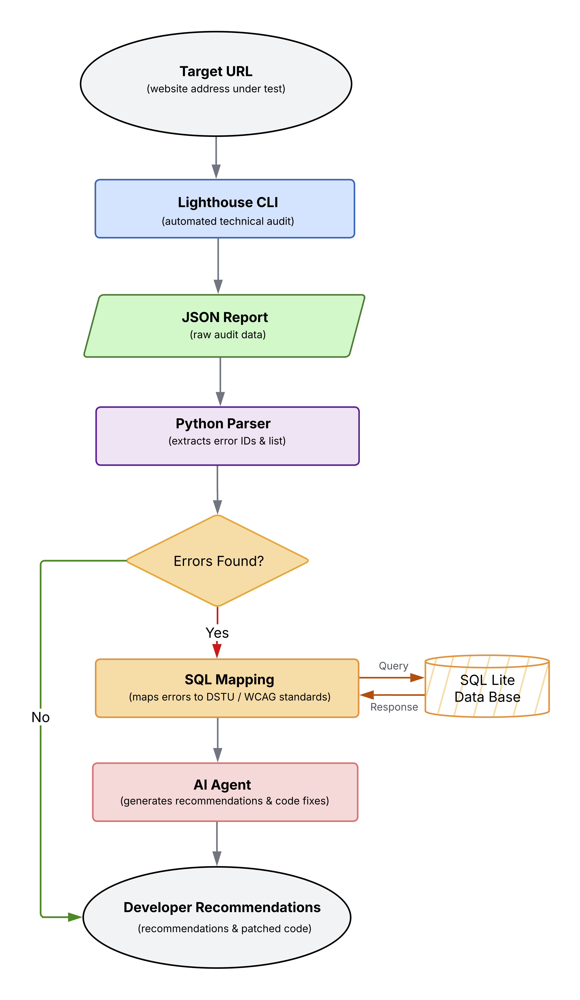

# ♿ Accessible Web Pipeline (PoC)

An intelligent engineering framework aligned with strict compliance standards (**DSTU EN 301 549 / WCAG 2.2**), designed to automate web accessibility audits and provide automated code remediation through RAG-powered AI agents.

> 🎓 **Academic Context:** 
> Developed as part of the Bachelor's Thesis at V. N. Karazin National University (Supervised by Assoc. Prof. I. Zaretska). 
> 
> 📄 **Conference Presentation & Publication:**  
> Presented at the *[7th International Scientific and Practical Conference "Research in Science, Technology and Economics"](https://isu-conference.com/en/archive/research-in-science-technology-and-economics-06-05-26/)* (Luxembourg, May 6–8, 2026).  
> * **Proceedings ISBN:** `979-8-89704-985-1`  
> * **DOI:** 10.70286/ISU-06.05.2026.009

---
## 🔬 Research Background & Motivation

Ensuring digital accessibility (a11y) is a critical global challenge in modern web development, driven by complex regulatory, social, and technological factors:

> [!IMPORTANT]
> 🇪🇺 The **[European Accessibility Act (EAA)](https://eur-lex.europa.eu/eli/dir/2019/882/oj)** became **applicable on June 28, 2025**, legally mandating digital accessibility for key products and services across the EU market.

* **Legislative Imperative:** Compliance with standards like [WCAG 2.2](https://www.w3.org/TR/WCAG22/) and [DSTU EN 301 549](https://online.budstandart.com/ua/catalog/doc-page.html?id_doc=97742) (or US [ADA](https://www.ada.gov/)) is now a baseline for global software development.
* **Social Impact:** Over 1.3 billion people (16% globally) live with disabilities according to [World Health Organization (WHO)](https://www.who.int/news-room/fact-sheets/detail/disability-and-health). Accessible digital services are essential for universal inclusion.
* **Methodological Gap:** Developers often lack systematic expertise in WCAG 2.2 / DSTU EN 301 549, creating a need for automated tools to bridge compliance auditing and front-end refactoring.

---

## 📊 Empirical Foundation & Key Findings

### Case Study: Ukraine 🇺🇦 
As part of a Bachelor’s thesis, an express-audit of 14 key web resources across 4 categories was conducted using Google Lighthouse:

1. **Governmental Portals** (e.g., Diia, MES, Pension Fund)
2. **Higher Education Institutions** (e.g., Karazin University, KPI, KNU)
3. **Commercial Core Services** (e.g., Ukrzaliznytsia, Privat24, Nova Poshta, Kyivstar)
4. **Healthcare Services** (e.g., MoH, eHealth)

**Core Systemic Violations Identified:**
* **WCAG 4.1.2 (Name, Role, Value):** Semantic flaws in interactive HTML elements (invisible to screen readers). 
* **WCAG 1.4.3 (Contrast Minimum):** Low contrast, hindering readability for low-vision users.
* **WCAG 1.1.1 (Non-text Content):** Missing `alt` attributes on informative graphics.

---

## 🏛️ System Architecture & RAG Pipeline

From a technical perspective, the system functions as a **full-cycle automated pipeline**. The core architecture relies on an autonomous AI agent built using _LangChain_ and an _SQLite database_. The workflow covers the entire process from automated testing via the _Lighthouse CLI_ to intelligent code remediation. Using _RAG_, the agent maps technical errors to specific clauses of DSTU EN 301 549, which provides strict traceability and significantly reduces hallucinations by grounding the model in retrieved standard text. 

<p align="center">
  
</p>

### 🔄 Core Pipeline Workflow

The complete auditing and remediation lifecycle consists of the following logical stages:

1. **Automated Diagnostics (Lighthouse CLI):** 
  Runs a headless audit for a target URL and generates a raw `JSON Report`.

2. **Data Filtering & Parsing (Python Parser):** 
   Parses raw JSON to extract error IDs, descriptions, and CSS selectors.

3. **Conditional Validation:** 
   Evaluates whether accessibility defects are present: terminates successfully if compliant, or all the detected issues proceed to the context mapping stage.

4. **Matching in DSTU (SQL Mapping):** 
   Maps technical error codes to DSTU EN 301 549 / WCAG 2.2 clauses.

5. **AI Remediation (Llama 3 Agent):** 
  The local Llama 3 AI Agent (via LangChain) analyzes the payload and generates ready-to-use, accessible HTML code patches.

6. **Developer Recommendations:** 
   Outputs a structured report with regulatory traceability and ready-to-use code fixes.

---
## ⚙️ Installation

**Requirements:** Python 3.11+, Node.js (for Lighthouse), [Ollama](https://ollama.com/).

```bash
git clone https://github.com/natashasemenova/a11y-ai-auditor.git
cd a11y-ai-auditor

# Python dependencies
pip install -r requirements.txt

# Lighthouse CLI
npm install -g lighthouse

# Local LLM
ollama pull llama3
```
---

## 💻 Practical Execution & Sample Output

### 1. Run the Audit (Lighthouse CLI)

Open your system **Terminal** and run a headless Lighthouse audit. Replace the URL with your target site; in this example we audit the Nova Poshta website (`novaposhta.ua`):

```bash
lighthouse https://novaposhta.ua/ --output=json --output-path=./report.json --chrome-flags="--headless"
```

### 2. Run the RAG Agent

Run the agent from the Terminal or from a Python IDE (e.g., Spyder, whose Variable Explorer is handy for step-by-step debugging):

```bash
python main_agent.py
```

> **Prerequisite:**
> - The Ollama server must be running and the Llama 3 model must be available locally (`ollama list`).
> - Run the script from the project folder, so that `standards.db` and `report.json` are found.

### 3. Sample Output

For each audit ID found in the knowledge base (`audit_mapping`), the agent retrieves the matching DSTU clause and generates a remediation report. Example run on `novaposhta.ua`:

- **Total audited issues:** 24 · **Matched in DB:** 1 (`color-contrast`)
- **Processing time:** 20.70 s (total AI time: 40.53 s)

> **DSTU EN 301 549, Clause 9.1.4.3 (Contrast):** Text and images of text must have a contrast ratio of at least 4.5:1.

The agent responds in Ukrainian, the language of the source standard (shown as generated):

> **Пояснення:** У ДСТУ 9.1.4.3 визначено мінімальний рівень контрастності тексту та зображень тексту, який повинен бути не менше 4.5:1 для звичайного тексту. Це важливо, тому що люди з порушеннями зору можуть мати труднощі при прочитанні тексту з низьким контрастом.
>
> **Порада розробнику:** забезпечте мінімальний рівень контрастності, визначений у ДСТУ 9.1.4.3:
>
> ```html
> <style>
> body {
>   background-color: #f2f2f2; /* світлий фон */
> }
> .text {
>   color: #333; /* темний текст */
>   font-weight: bold;
> }
> </style>
> ```

📄 Full output with English translation: [`examples/sample_output.md`](examples/sample_output.md)

---

## ⚠️ Limitations

- **Coverage is limited to the knowledge base.** Only audit IDs present in `audit_mapping` are analyzed; all other Lighthouse findings are listed but not remediated.
- **Automated testing is partial.** Lighthouse detects only a subset of accessibility issues; manual testing with assistive technologies is still required.
- **Local model quality.** Llama 3 can produce inaccurate or inconsistent advice (for example, factual slips or mixed languages). Generated code must be reviewed before use.
- **Performance.** Generation time depends on hardware and on whether the model is already loaded in memory.

---

## 📚 Citation

If you use this work, please cite the conference publication:

```bibtex
@inproceedings{semenova2026wcag,
  author    = {Semenova, Nataliia and Zaretska, I. T.},
  title     = {{Стандарти WCAG 2.2: автоматизоване тестування веб-доступності}},
  note      = {English title: WCAG 2.2 Standards: Automated Web Accessibility Testing},
  booktitle = {Research in Science, Technology and Economics: Proceedings of the 7th International Scientific and Practical Conference},
  address   = {Luxembourg},
  month     = may,
  year      = {2026},
  pages     = {228--231},
  isbn      = {979-8-89704-985-1},
  doi       = {10.70286/ISU-06.05.2026.009},
  language  = {ukrainian}
}
```

---

## 🛡️ License

Developed for academic research and educational purposes under the [MIT License](LICENSE).
